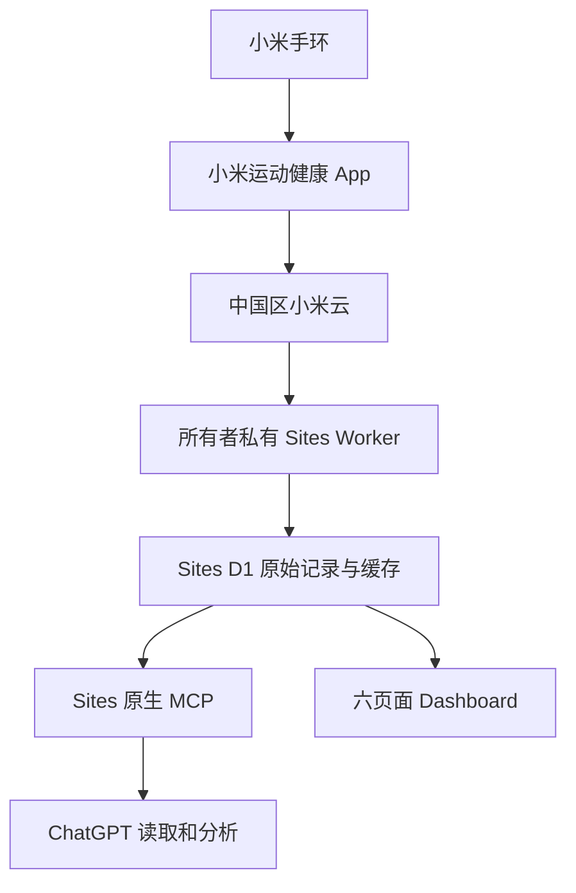

# Xiaomi Band MCP · ChatGPT Work + Sites

用 **ChatGPT Work + Sites、TypeScript Worker 和 Sites D1** 搭建自己的小米运动健康云端数据接口，并让 ChatGPT 通过 Sites 原生 MCP 查询数据、按需同步。

**项目定位：读取、同步、保留与准确提供数据。健康分析交给 ChatGPT。** 不开发新的服务端健康评分或训练结论；当前兼容接口中已有的简单统计予以保留。

这是当前可运行实现的脱敏开源快照，不含个人数据库、真实健康样本、账号凭据、站点 ID 或私有 Git 历史。公开的是代码；你部署的健康数据 Site 必须保持所有者私有。

## 架构



App 需要先把手环数据上传到云端；MCP 不连接蓝牙，不控制手机同步。今天的数据始终视为未完整。Windows 仅在首次本地认证或配置时可能使用，不需要持续开机。

## 已实现与边界

| 项目 | 状态 |
|---|---|
| 中国区 `miothealth` passToken → STS 认证 | 实现；私有部署曾通过真实账号验证。其他账号仍须自行验证 |
| Worker `fetch` / Web Crypto / 纯 JS RC4 | 实现；无 Python 运行时、无 pip 依赖 |
| 21类参考渠道 | 已配置；各账号可能返回空结果，不是全部小米数据目录 |
| 运动附加源响应 | 新抓取时完整脱敏保存及留版本，旧投影缓存明确缺原文，不自动补抓 |
| 异常源记录 | 单条外层异常单独隔离，保留错误值，不阻断同页有效记录；协议错误仍停止 |
| 原始记录与内容版本 | D1 `raw_records` + `raw_versions`；`get_raw_record` 分块读取脱敏当前原文，快照校验，历史版本读取待补 |
| 缓存覆盖 | `get_sync_status` 可选日期范围与指标，区分缓存、空页、失败、未检查，上传完整性不推测 |
| 主动同步与进度 | `trigger_sync` / `get_sync_progress`，默认今天、昨天增量，独立历史断点 |
| 历史回填 | 初始计划365天；分批续传，**不是已证实的小米云保留上限** |
| 步数 | 使用已通过本人 App 参考值验证的云端日报口径，不叠加手机和手环分钟来源；新账号需独立核验 |
| 睡眠 | 按记录校验分期、单位及边界；不完整与算术一致性分开标记 |
| 运动原生心率 | FDS 文件获取/解密/缓存；已验证格式8、记录版本4、未压缩文件。其他格式保留或回退，不能宣称全运动兼容 |
| MCP分页 | 通用记录每页最多2000条；心率31天/次，其他常规明细90天/次 |
| 睡眠 HRV 源字段 | 缓存分页读取；五个汇总字段按所有者 App 对账为 ms，其余单位与算法未验证。见 [HRV说明](docs/HRV_SOURCE_PASSTHROUGH.md) |
| 未知恢复单位等 | 保留原值、不猜单位 |

`get_raw_record` 分块读取已保留的脱敏完整源 JSON；普通查询仍是规范化视图。新抓取的运动 operational 响应另存完整脱敏原文；旧投影缓存缺失的原文不能凭空恢复。详见 [原文契约](docs/RAW_READ_AND_COVERAGE.md) 和 [已知限制](docs/LIMITATIONS.md)。

## 复现前提

- 你自己的小米大陆账号、小米运动健康 App，以及能用的 `userId` / `passToken`。
- 当前账户实际具有 **ChatGPT Work + Sites、D1、环境 Secrets、原生 MCP 插件** 能力。是否可用以账户界面为准；不保证仅购买某种套餐就必然开放这些能力。
- 本地检查建议 Node.js 22 或24、npm；这些是开发工具，不是线上运行条件。
- 本项目使用未公开稳定承诺的私有接口；认证、数据类型及网络可达性可能变化。不会绕过验证码、二次验证或其他安全机制。
- 本仓库不代购服务、不创建付费资源。Sites/数据库/自动化的额度和计费取决于平台及账户，不能保证永久免费。

## 本地检查：不连接小米

```bash
git clone https://github.com/hao0527/xiaomi-band-mcp-sites.git
cd xiaomi-band-mcp-sites
npm ci
npm run typecheck
npm test
```

测试全部使用合成数据或 Mock 传输，不需要 Secrets，不进行真实小米登录。构建结果为 `worker/index.js` 与 `dist/server/index.js`；`.openai/hosting.json` 声明 D1 `DB` 和 `mcp`。不要把开发时可伪造身份头的本地环境暴露到互联网。

## 在 ChatGPT Work 中复现

按 [完整部署指南](docs/REPRODUCE_SITES.md) 操作。可以先把 [复现提示词](docs/WORK_PROMPT.md) 发给拥有 Sites 工具的 ChatGPT Work，并提供本仓库链接。

1. 读取仓库，执行合成测试。
2. **新建一个所有者唯一访问的 Site**，使用新的 Sites 项目 ID；本仓库故意未带 `project_id`，不能复用他人的 ID。
3. 按序应用 `drizzle/0000`—`0003` 空库迁移，声明 D1 `DB` 与原生 `mcp`；构建并通过 Sites 正规流程私有部署。不要重复执行 `db/schema.sql` 和迁移，两者是替代初始化路径。
4. 在该 Site 的后端环境设置中配置 `MI_USER_ID`、`MI_PASS_TOKEN`，都设为 **Secret**。聊天中不要发送凭据，也不要让 Work 读取环境值。
5. 设置 `PERSIST_SYNC_ENABLED=true` 后重新部署。由你明确授权首次同步；先检查认证与最近两天结果，再决定是否跑历史回填。
6. 使用 Sites 发布时创建的个人 MCP 插件；工具未出现时刷新连接或新建对话。先读 `get_sync_status`，再按需调用 `trigger_sync`。
7. 可选：确认平台额度后配置云端定时任务，见 [自动同步](docs/AUTOMATION.md)。本仓库本身不会创建定时任务。

**不要部署为公开 Site，也不要原样部署到无身份保护的公开 Cloudflare Worker。** `/api/sync` 等后台入口依赖 Sites 平台所有者私有访问边界；意图头不是认证凭据。

## 首次账号凭据

本仓库不含密码登录、验证码处理、自动 Cookie 提取器或账号登录页面。请仅在你控制的本地环境按参考项目作者说明取得自己账号的凭据，参见 [Aaron-gx/mihealth-api](https://github.com/Aaron-gx/mihealth-api) 的登录说明。它是独立第三方工具，运行前自行审查；不要把其密码命令、配置文件或成功认证响应发到 ChatGPT 或 GitHub。

登录 `mi.com` 并不自动证明已经获得健康服务会话。本后端实际需要 `MI_USER_ID` 与 `MI_PASS_TOKEN`；`ssecurity` 和 `serviceToken` 在后端会话中交换，**不需要上传为额外配置，也不保存到D1**。被安全验证拦截时停止，在官方登录界面完成必要验证，不自动重试或绕过。

## MCP工具

默认目录展示 **10项工具**，旧20个名称保留兼容调用。见 [工具清单与调用流程](docs/MCP.md) 和 [目录收敛说明](docs/MCP_SURFACE.md)：

- `trigger_sync`、`get_sync_progress`、`get_sync_status`
- `list_available_metrics`、`get_metric_records`（单/多指标，紧凑元数据）、`get_raw_record`
- `get_daily_summary`（单日或最多7日事实数据）、`get_hrv_trend`（睡眠HRV源字段）
- `get_activity_detail`：运动列表先用 `get_metric_records(metrics=["sport"])` 读取
- `get_activity_heart_rate_samples`：通过 `next_offset` 读完整缓存曲线

查询工具只读取 D1 缓存；`trigger_sync` 是唯一标为写入的 MCP 工具。AI应主动把“缓存没有数据”“尚未同步”“云端成功返回空结果”和“接口失败”分开，不编造缺失指标。

## 目录

| 目录 | 内容 |
|---|---|
| `src/collector/` | 登录、Cookie、签名、RC4、API与解析 |
| `src/persistence.ts` / `src/mcp-sync.ts` | D1存储、增量/历史断点、MCP |
| `src/workout-*.ts` | 原生文件通道、限定解码器与兼容统计 |
| `src/dashboard.ts` | 当前六页中文深色UI，不含其他个人站点链接 |
| `drizzle/` | 空库迁移，含原生运动文件缓存表 |
| `tests/` | 纯合成数据/Mock测试 |
| `docs/` | 复现、限制、MCP、自动化与安全文档 |

## 贡献与后续方向

优先处理实际字段丢失、缓存可读性、已知渠道覆盖和历史完整性。保留未知原值，不猜单位；不为了扩展架构而重写正常功能，也不为了工具数量增加接口。既有周报告、审计、分析和重复明细入口只保留兼容分发，退出默认工具目录。

MIT，详见 [LICENSE](LICENSE) 与 [NOTICE.md](NOTICE.md)。保留全部上游版权声明。与小米或 OpenAI 无隶属或背书关系。
